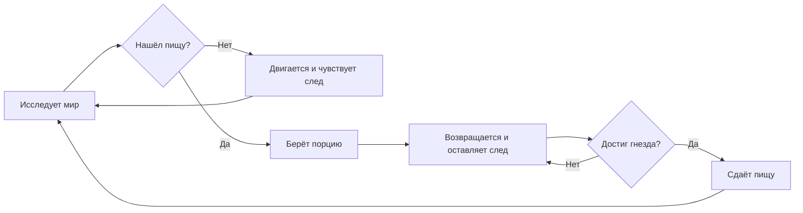
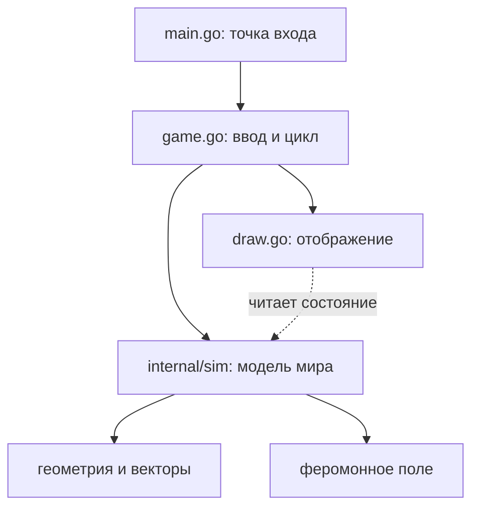

# AntLab — техническое задание

> **AntLab** — интерактивная двумерная симуляция муравьиной колонии на **Go**. Муравьи исследуют мир, находят пищу, возвращаются в гнездо и оставляют феромонные следы. Из простых локальных правил постепенно формируются коллективные маршруты.
>
> **Тип документа:** техническое задание и рабочий план разработки, не README и не инструкция по копированию готового решения.
>
> **Главная цель:** написать собственный движок симуляции на чистом Go, потренировать геометрию, структуры данных, тестирование, профилирование и — после рабочей последовательной версии — конкурентность. Визуализация нужна, чтобы видеть и исследовать поведение системы.

---

## 1. Идея и границы проекта

Пользователь запускает программу и видит двумерное поле. На нём находится муравейник, несколько источников еды и множество муравьёв. Вначале муравьи исследуют пространство. Обнаружив еду, они забирают порцию, возвращаются в гнездо и оставляют химический «след». Остальные муравьи могут чувствовать следы и выбирать направления движения с учётом их интенсивности. Со временем колония начинает пользоваться возникшими тропами.

При этом **никакой центральный алгоритм не указывает каждому муравью путь к еде**. Поведение колонии должно возникать из локальных решений отдельных агентов.

### Что входит в проект

- собственная модель мира, движения и поведения агентов;
- двумерная геометрия и простые правила взаимодействия;
- карта феромонов, их нанесение, испарение и позднее — распространение;
- отрисовка, управление симуляцией и визуализация следов;
- тесты и измерения производительности;
- опционально: препятствия, несколько колоний, сохранение сцен, конкурентное обновление.

### Что **не** нужно для первой версии

- реалистичная биология, сложная физика и моделирование отдельных молекул;
- сервер, REST API, регистрация пользователей, Docker, Kafka и микросервисы;
- нейросети и готовые библиотеки поведения агентов;
- SQL как обязательный компонент: хранение можно добавить позднее;
- преждевременная многопоточность и сложная архитектура.

**Приоритет:** интересная и корректная симуляция → измерения → оптимизация → новые механики.

---

## 2. Цели и критерии успеха

### Учебные цели

1. Уверенно работать с `struct`, `slice`, методами, пакетами и модулями Go.
2. Отделять вычислительное ядро от графической оболочки.
3. Реализовать собственную 2D-математику: векторы, расстояния, направления, углы.
4. Работать с большими массивами состояния и контролировать количество аллокаций.
5. Писать unit-тесты и бенчмарки на важные операции.
6. Использовать `go test -race`, `pprof` и сравнивать разные реализации на одинаковой нагрузке.
7. При наличии измеренной потребности — распараллеливать вычисления без гонок данных.

### Продуктовые цели MVP

- Симуляция запускается одной командой и показывает анимированный мир.
- Муравьи двигаются без выхода за границы карты.
- На поле есть гнездо и источники еды с конечным запасом.
- Муравьи способны находить пищу, брать её и доставлять домой.
- Феромоны влияют на движения агентов, их концентрация со временем снижается.
- Можно поставить симуляцию на паузу, перезапустить её, добавить еду и увидеть статистику.
- Поведение воспроизводимо при фиксированном `seed` генератора случайных чисел (при одинаковых настройках и порядке вычислений).

### Не ставим искусственные обещания производительности

Вместо «гарантированно 20 000 муравьёв при 60 FPS» измеряем скорость на заранее выбранных сценариях: **100 / 1 000 / 5 000 / 20 000 агентов**. Отдельно фиксируем время *шага симуляции* и время *отрисовки*. Цель — показать воспроизводимое улучшение относительно собственной первой версии.

---

## 3. Модель мира

### 3.1. Координаты и время

- Мир — прямоугольник шириной `W` и высотой `H` в условных единицах.
- Позиции агентов — вещественные 2D-координаты `(x, y)`.
- Время симуляции обновляется дискретными шагами `dt` (желательно фиксированными, чтобы поведение не менялось от FPS).
- Геометрия и поведение не должны зависеть от размера окна в пикселях.

### 3.2. Муравей

Минимально хранит:

| Поле | Значение |
|---|---|
| Позиция | Точка `(x, y)` |
| Направление | Угол или нормализованный вектор |
| Скорость | Модуль скорости движения |
| Состояние | `searching` или `returning` |
| Переносимая еда | `0` или `1` порция |
| Индивидуальное случайное состояние | Опционально, для воспроизводимости |

Поведение: исследует мир, замечает еду в пределах заданного радиуса, подбирает порцию, возвращается в гнездо, передаёт еду и снова отправляется на поиски. В дальнейшем добавляются феромоны и препятствия.

### 3.3. Муравейник

- Положение и радиус взаимодействия.
- Счётчик доставленной еды.
- Начальная точка появления муравьёв.
- В первой версии гнездо одно и неподвижное.

### 3.4. Источник пищи

- Положение, радиус и доступное число порций.
- При подборе запас уменьшается ровно на единицу.
- Источник с нулевым запасом больше нельзя использовать.
- Пользователь может создавать новые источники мышью.

### 3.5. Феромонное поле

Начни с регулярной 2D-сетки, а не с индивидуального объекта на каждую «каплю» следа. Каждая ячейка содержит концентрацию феромона. Для минимальной модели достаточно **одного типа следа от возвращающихся с едой муравьёв**. В более развитой модели можно использовать два поля: путь к пище и путь к дому.

Правила:

1. Муравей в нужном состоянии добавляет небольшую концентрацию в ячейку своего положения.
2. Каждый шаг концентрация уменьшается — испарение.
3. Ищущий муравей сравнивает интенсивность в нескольких точках перед собой и выбирает направление с шумом.
4. Позднее концентрация может частично распространяться на соседние ячейки — диффузия.
5. Интенсивность ограничена конечным диапазоном; отрицательных и `NaN`-значений нет.

**Важный нюанс:** одних следов к еде недостаточно, чтобы гарантировать успешное возвращение. Для MVP допустимо возвращение по направлению к известной позиции муравейника (упрощённая навигация). Позже это можно заменить «домашним» феромоном или другими локальными правилами. Это осознанный компромисс, а не биологически точная модель.

### Схема процесса



---

## 4. Управление и визуализация

### Экран

- Поле с муравейником, источниками еды и движущимися муравьями.
- Муравьи изображаются маленькими направленными треугольниками или стрелками.
- Феромонная сетка отображается как полупрозрачная тепловая карта; её можно скрывать.
- HUD показывает: число муравьёв, число источников, запас/собранную еду, время симуляции, FPS и длительность шага симуляции.

### Ввод

| Действие | Предлагаемое управление |
|---|---|
| Пауза / продолжение | `Space` |
| Перезапуск сцены | `R` |
| Добавить источник еды | ЛКМ |
| Показать / скрыть феромоны | `P` |
| Изменить скорость симуляции | `+` / `-` (опционально) |
| Показать / скрыть метрики | `Tab` (опционально) |

Конкретные клавиши можно поменять. Важно, чтобы управление не смешивалось с бизнес-логикой мира.

---

## 5. Рекомендуемая организация Go-проекта

Один модуль, несколько файлов и **два логических слоя**: визуализация и симуляция.

```text
antlab/
├── go.mod
├── go.sum
├── main.go                 # запуск приложения
├── game.go                 # игровой цикл, ввод пользователя
├── draw.go                 # отрисовка мира
├── internal/
│   └── sim/
│       ├── world.go        # состояние мира и один шаг симуляции
│       ├── ant.go          # данные и поведение муравьёв
│       ├── vector.go       # простая 2D-геометрия
│       ├── food.go         # источники еды
│       ├── pheromone.go    # сетка феромонов
│       ├── world_test.go   # тесты мира
│       └── ...             # добавлять по необходимости
├── assets/                 # необязательно: спрайты, иконки
├── benchmarks/             # необязательно: результаты замеров
└── docs/                   # необязательно: схемы, скриншоты
```

Сразу создавать все файлы **не нужно**. Начни с `main.go`, `game.go`, `draw.go`, `world.go`, `ant.go`, `vector.go`.

### Как работают модули и пакеты

- **Module** — весь проект, определяется корневым `go.mod`.
- **Package** — код одной директории. Например, все `.go` файлы в `internal/sim/` имеют `package sim` и видят друг друга без импорта.
- **Import** — обращение к *пакету*, не к файлу. Путь импорта состоит из пути модуля + относительного пути папки.
- Имена с большой буквы (`World`, `Step`, `NewWorld`) видимы другим пакетам; с маленькой — только внутри своего пакета.
- `internal/` предназначен для внутренних пакетов, которые не должны импортироваться посторонними проектами.
- Здесь нужен **один `go.mod`**, не отдельный модуль для каждой папки.

### Зависимости

- **Go** — вся модель и вычисления.
- **Ebitengine** — только окно, ввод, текст/фигуры и отрисовка.
- **Стандартная библиотека Go** — случайные числа, тестирование, профилирование, файлы.
- **SQLite** — необязательное расширение для сохранения сцен/серий экспериментов.

Пример создания модуля (заменить имя пользователя):

```bash
go mod init github.com/USERNAME/antlab
go get github.com/hajimehoshi/ebiten/v2
go run .
```

Для тестов и проверок:

```bash
go test ./...
go test -race ./...
go test -bench=. ./...
go vet ./...
go mod tidy
```

**Принцип зависимостей:** `main` / `game` может импортировать `internal/sim`, но `internal/sim` **не импортирует Ebitengine**. Это позволяет прогонять тысячи шагов модели в тестах без графического окна.



---

## 6. План разработки на 7 этапов

Срок **3–7 дней на MVP** возможен при небольшом объёме фич и базовом знакомстве с Go. Тестирование, качественная визуализация и серьёзная оптимизация могут занять больше времени. Переходить к следующему этапу нужно по критерию готовности, а не по календарю.

### Этап 1. Поле и движение (условно день 1)

**Изучить:** `struct`, слайсы структур, методы, `math`, `math/rand`, `Update`/`Draw` Ebitengine, 2D-векторы.

**Сделать:** окно около `1000×700`, 100–300 движущихся муравьёв, постоянную скорость, небольшое случайное отклонение направления, обработку границ.

**Готово, когда:** все муравьи двигаются, остаются внутри карты, не зависают; можно изменить их число одним параметром.

### Этап 2. Еда и жизненный цикл (условно день 2)

**Изучить:** простые конечные автоматы; расстояние между точками; отделение состояния от отрисовки.

**Сделать:** гнездо, источники еды, состояния `searching`/`returning`, подбор и доставка порции, счётчик собранной еды.

**Готово, когда:** агент без феромонов способен иногда найти еду и принести её в гнездо; запас пищи и счётчик гнезда меняются корректно.

### Этап 3. Феромонная сетка (условно день 3)

**Изучить:** двумерный массив как плоский `slice`, перевод координаты мира в индекс ячейки, испарение.

**Сделать:** сетку концентраций, нанесение феромонов на обратном пути, испарение за шаг, отрисовку тепловой карты.

**Готово, когда:** след появляется при возвращении и постепенно исчезает; концентрации не становятся отрицательными.

### Этап 4. Реакция на следы (условно день 4)

**Изучить:** нормализацию векторов, повороты, несколько датчиков перед агентом, простые вероятностные решения.

**Сделать:** три точки «обоняния» — слева, прямо и справа; выбор направления с учётом концентрации и случайности; возможность менять чувствительность.

**Готово, когда:** наличие феромонов статистически меняет маршруты; при одинаковом seed результаты воспроизводимы; без следов муравьи продолжают исследовать карту.

### Этап 5. Песочница и наблюдаемость (условно день 5)

**Изучить:** обработку ввода, параметры модели, разделение модельного и экранного времени.

**Сделать:** паузу, перезапуск, добавление еды мышкой, отображение числа агентов, доставленной еды и времени шага.

**Готово, когда:** пользователь может провести эксперимент без изменения исходников.

### Этап 6. Производительность (условно день 6)

**Изучить:** `testing.B`, `go test -bench`, `pprof`, выделения памяти, устройство слайсов.

**Сделать:** отдельный benchmark обновления мира **без рисования**, тесты на 100/1 000/5 000/20 000 муравьёв; замер `ns/op`, `B/op`, `allocs/op`; профилирование; минимум одну оптимизацию с повторным замером.

**Готово, когда:** есть таблица результатов «до/после» и ты можешь объяснить, что ускорилось, что замедлилось и почему.

### Этап 7. Конкурентность и качество (условно день 7+)

**Изучить:** goroutines, `sync.WaitGroup`, безопасный доступ к данным, гонки, детерминированность обновлений.

**Сделать:** сначала измерить, есть ли смысл в параллелизме. Затем при желании распараллелить независимую часть вычислений с раздельными фазами чтения и записи. Прогнать `go test -race`; добавить тесты граничных условий и документацию по запуску.

**Готово, когда:** параллельная версия не теряет еду, не портит феромоны и не имеет data race; заявленное ускорение подтверждено бенчмарком. Если многопоточность ухудшает результат, это тоже полезный технический вывод.

---

## 7. Важные инженерные правила

### Детерминированность

В режиме экспериментов используй фиксированный seed и фиксированный шаг времени. Изменение порядка вычислений, особенно при параллельной обработке, может менять результаты; детерминированность нужна прежде всего для корректного сравнения алгоритмов.

### Чёткий порядок обновления

Продумай порядок фаз: агент читает состояние мира → выбирает действие → меняется состояние → обновляется феромонное поле. Избегай скрытой зависимости результата от порядка обхода слайса. Для многопоточности особенно полезно разделять *чтение прошлого состояния* и *запись нового состояния*.

### Корректность важнее FPS

Если две особи одновременно претендуют на последнюю порцию еды, нельзя выдать две. Если концентрация феромонов записывается параллельно, нельзя терять обновления без явного решения об этом в модели. Проверяй инварианты тестами.

### Отрисовка не должна диктовать модель

Ни одна сущность в `internal/sim` не должна требовать `ebiten.Image` или ссылку на окно. Мир должен обновляться в headless-режиме.

### Без преждевременных абстракций

Не создавать `utils`, `common`, `engine/manager/factory` и пакеты «на будущее». Лучше маленький понятный код, который затем будет легко перестроить.

---

## 8. Список тестов и инвариантов

**Движение и геометрия**

- Нулевой и отрицательный `dt` обрабатываются согласно явной политике.
- Муравей не оказывается за пределами мира после разрешения границ.
- Нормализация нулевого вектора не создаёт `NaN`.
- Преобразование мировых координат в индекс сетки безопасно на границах.

**Еда**

- Запас еды никогда не отрицателен.
- Одна особь переносит не более одной порции.
- Доставка увеличивает счётчик гнезда ровно на одну порцию.
- Суммарная еда сохраняется: оставшаяся в источниках + переносимая + доставленная = изначальная + добавленная пользователем.

**Феромоны**

- Испарение без новых следов не увеличивает концентрацию.
- Концентрация остаётся в допустимом диапазоне.
- Поле без муравьёв со временем затухает.

**Воспроизводимость и производительность**

- При одинаковых seed и последовательности команд последовательная симуляция выдаёт одинаковое состояние после N шагов.
- Замеры не включают работу GPU/окна, если измеряется ядро.
- Результаты и параметры эксперимента записаны: версия Go, CPU, число агентов, размеры поля и сетки, `dt`, seed.

---

## 9. Оптимизация: реальные вопросы для исследования

Не оптимизируй всё сразу. Для каждого изменения формулируй гипотезу, делай замер, меняй одну вещь и повторяй замер.

| Направление | Вопрос для эксперимента |
|---|---|
| Расположение данных | Что быстрее: слайс структур или раздельные слайсы координат/направлений? |
| Размер феромонной сетки | Как меняются расход памяти и качество троп при увеличении размера ячейки? |
| Испарение | Сколько времени занимает обход всей сетки на каждом шаге? |
| Аллокации | Какие временные объекты создаются в `Step()` и можно ли их избежать? |
| Параллелизм | При каком числе муравьёв и ядер worker pool начинает окупаться? |
| Обновление | Как меняется результат при раздельных фазах чтения/записи? |
| Визуализация | Что ограничивает FPS: физика, построение изображения феромонов или рисование агентов? |

Не нужно обязательно внедрять все оптимизации. **Для сильного учебного проекта достаточно нескольких тщательно измеренных решений.**

### Шаблон записи эксперимента

```text
Гипотеза: _______________________
Нагрузка: N=____, W×H=____, размер сетки=____
Среда: Go=____, CPU=____, seed=____
До: ____ ns/op, ____ B/op, ____ allocs/op
После: ____ ns/op, ____ B/op, ____ allocs/op
Вывод: __________________________
```

---

## 10. Возможности после MVP (не обязательны в первую неделю)

### Геометрия и поведение

- **Препятствия:** отрезки, окружности, многоугольники, обход и взаимодействие с ними.
- **Лабиринты:** оценка, возникают ли обходные тропы.
- **Несколько колоний:** отдельные гнёзда, феромоны, конкуренция за ресурсы.
- **Разные роли агентов:** разведчики, сборщики, охранники; возможно, простая смена ролей.
- **Параметры поведения:** скорость, дальность сенсоров, случайный шум, интенсивность следа.

### Инженерные расширения

- **Редактор мира:** мышью добавлять/удалять препятствия, еду и гнёзда.
- **Сохранение и загрузка сцены:** сначала JSON, позже при желании SQLite.
- **Пакетные эксперименты без графики:** 100 запусков с разными параметрами, сравнение доставленной еды и времени до обнаружения источника.
- **Графики метрик:** эффективность колонии и затраты CPU по времени.
- **Конкурентная симуляция:** только после baseline и тестов.

### Идеи для собственного исследования

1. Какие параметры поведения быстрее формируют устойчивую тропу?
2. Как размер ячейки феромонов влияет на скорость и качество поиска?
3. Выгоднее ли более «случайные» разведчики или строгое следование сигналам?
4. Что происходит, если источник еды внезапно исчезает?
5. Как изменения геометрии препятствий влияют на распределение маршрутов?

---

## 11. Что показать в GitHub и резюме

Полезные артефакты после MVP:

- короткий GIF или запись работы симуляции;
- краткое описание правил поведения (без лишней биологии);
- схема пакетов и инструкция запуска;
- unit-тесты на геометрию и инварианты;
- реальные benchmark-результаты и один CPU/heap профиль;
- маленькая заметка «что оптимизировал, почему и какой результат получил»;
- список ограничений модели.

**Возможная формулировка для резюме (заполнять только после реализации и замеров):**

> Developed a 2D agent-based ant colony simulation in Go with custom pheromone-field mechanics, deterministic testing, and profiling-driven optimizations. Improved simulation throughput by **[измеренный результат]** on **[описание тестовой нагрузки]**.

Нельзя указывать ускорение, число поддерживаемых агентов или конкурентность, если это не реализовано и не измерено.

---

## 12. Definition of Done — MVP

- [ ] Приложение запускается локально через `go run .`.
- [ ] На поле отображаются гнездо, источники пищи и муравьи.
- [ ] Муравьи перемещаются и взаимодействуют с границами.
- [ ] Есть состояния поиска и возвращения с едой.
- [ ] Доставка пищи корректно учитывается в статистике.
- [ ] Муравьи оставляют феромоны, которые испаряются.
- [ ] Феромоны оказывают заметное влияние на движение.
- [ ] Есть пауза, рестарт и добавление еды мышью.
- [ ] Ядро симуляции отделено от Ebitengine.
- [ ] Есть тесты основных инвариантов.
- [ ] Есть хотя бы один воспроизводимый benchmark ядра.
- [ ] В репозитории описано, как запустить проект и повторить тест.

### Самая первая задача

**Написать мир с 300 случайно движущимися муравьями**, без еды и феромонов. Муравьи — треугольники, повёрнутые по направлению движения. Скорость постоянная, направление немного меняется, границы обрабатываются. Когда это стабильно работает — переходить к гнезду и еде.

---

## 13. Ссылки на документацию

- [Go: Organizing a Go module](https://go.dev/doc/modules/layout)
- [Go: A Tour of Go](https://go.dev/tour/)
- [Go: testing package](https://pkg.go.dev/testing)
- [Go: Data Race Detector](https://go.dev/doc/articles/race_detector)
- [Go: Diagnostics and profiling](https://go.dev/doc/diagnostics)
- [Ebitengine — официальный сайт](https://ebitengine.org/)
- [Ebitengine — примеры](https://ebitengine.org/en/examples/)

---

*Этот документ — рабочее ТЗ. Решения по структурам данных, правилам движения, способу обновления феромонов и оптимизациям намеренно не зафиксированы до уровня готового кода: это основная учебная часть проекта.*
